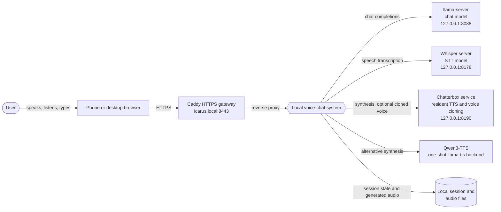
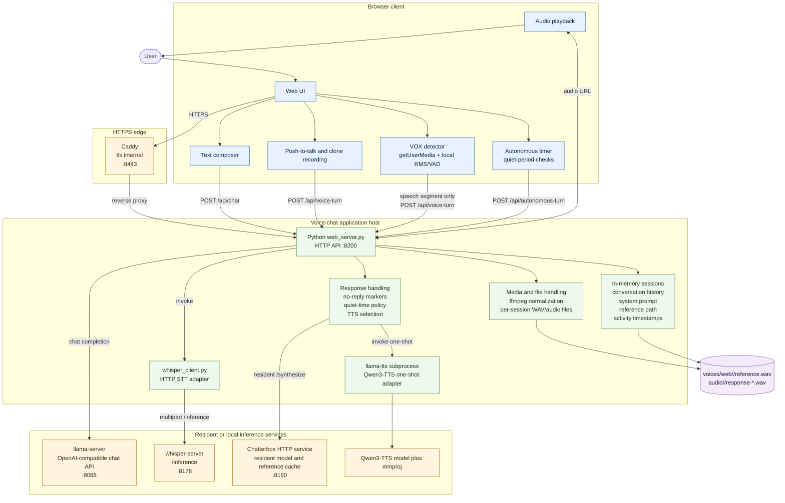
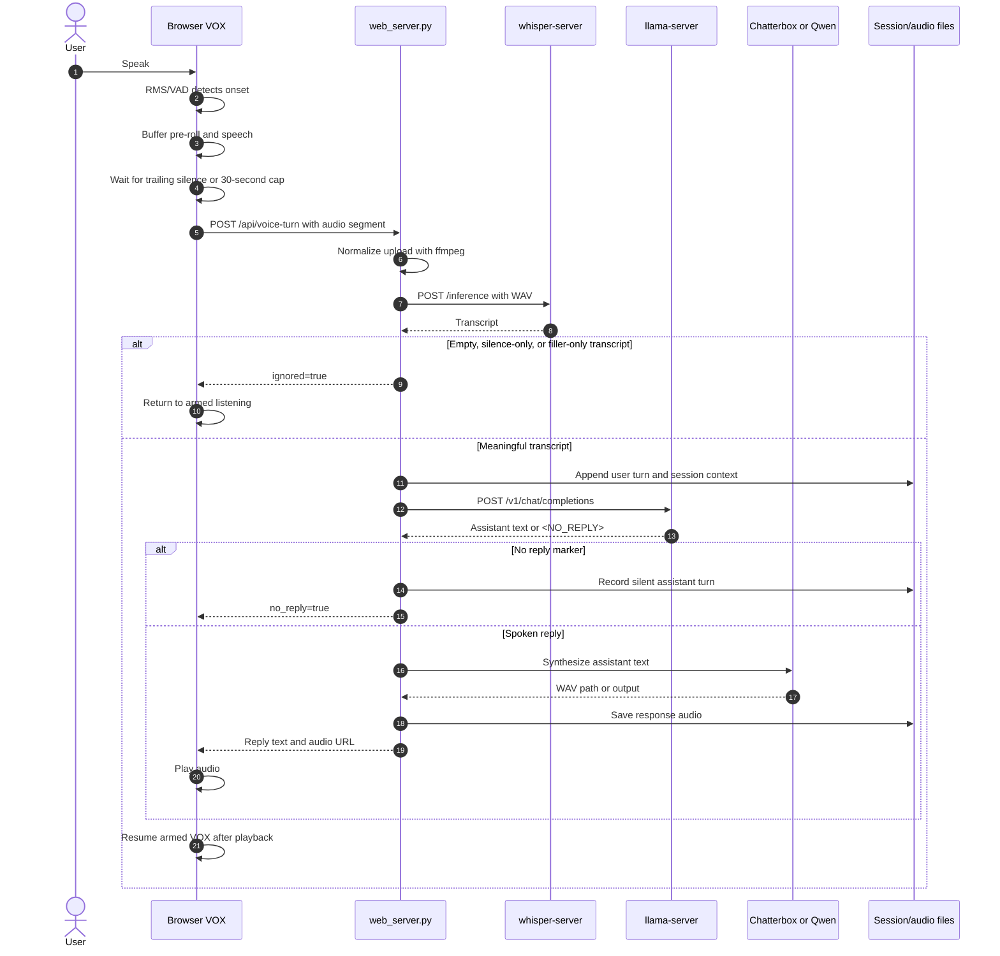

# Voice-chat architecture

This document uses three views:

1. **System context**: the voice-chat system as a black box and the systems around it.
2. **System diagram**: the internal runtime pieces and their boundaries.
3. **Sequences**: the two flows that are easiest to misunderstand: a VOX turn and an autonomous check-in.

The diagrams describe the browser-based deployment on `icarus.local`.

## 1. System context — black box



The browser is the only client-facing part. The inference services are local
supporting systems; they are not exposed directly to the browser.

## 2. System diagram — white box



### Runtime boundaries

- **Browser** owns microphone permission, local VOX analysis, recording, the
  autonomous timer, and playback. It does not call the model services directly.
- **`web_server.py`** owns cookie-scoped sessions, history, prompts, quiet-time
  eligibility, no-reply handling, media conversion, and orchestration.
- **Whisper** is resident and receives normalized audio through its HTTP
  `/inference` endpoint.
- **Chatterbox** is resident and keeps the loaded TTS model and processed voice
  conditionals in memory. Qwen3-TTS remains a separate one-shot subprocess
  alternative.
- **`llama-server`** is resident and is the only chat-model process in the
  normal browser path.
- **Session memory is process-local**. Restarting the web server discards
  conversations, system prompts, timestamps, and active session associations.

## 3. Sequence — normal VOX turn



VOX is half-duplex: the browser does not listen for a new utterance while an
assistant response is being processed or played. Local detection prevents idle
microphone audio from being uploaded, while the server-side transcript filter
is the final guard before chat and TTS.

## 4. Sequence — autonomous check-in

```mermaid
sequenceDiagram
    autonumber
    actor User
    participant Browser as Browser JavaScript
    participant Web as web_server.py
    participant Chat as llama-server
    participant TTS as Chatterbox or Qwen

    User->>Browser: Complete a real text or voice turn
    Browser->>Browser: Reset timer and remain armed if VOX is enabled
    loop Every autonomous interval after the quiet threshold
        Browser->>Browser: Timer fires while page is open
        alt VOX recording, processing, speaking, another request, or audio playback
            Browser->>Browser: Defer and schedule another check
        else VOX armed or disabled
            Browser->>Web: POST /api/autonomous-turn
            Web->>Web: Check last_activity, threshold, and interval
            alt Not eligible
                Web-->>Browser: skipped=true
            else Eligible
                Web->>Chat: Private autonomous prompt plus elapsed quiet context
                Chat-->>Web: <NO_REPLY> or natural response
                alt <NO_REPLY>
                    Web-->>Browser: no_reply=true; no audio
                else Response text
                    Web->>TTS: Synthesize response
                    TTS-->>Web: Audio output
                    Web-->>Browser: Text and audio URL
                    Browser->>User: Display and play response
                end
            end
        end
    end
    User->>Browser: Speak or type again
    Browser->>Web: Normal chat or voice-turn request
    Browser->>Browser: Reset autonomous schedule
```

The wake-up mechanism is therefore **frontend timer plus backend eligibility
check**. The backend does not wake itself and cannot initiate a request while
no browser page is open. The model is invoked on every eligible interval; it is
free to return `<NO_REPLY>` or respond based on the accumulated quiet-time
context.

## Ports and bindings

| Component | Default binding | Role |
|---|---:|---|
| Caddy | `0.0.0.0:8443` | LAN HTTPS entry point and reverse proxy |
| Web server | `0.0.0.0:8200` | Browser UI and orchestration API |
| llama-server | `127.0.0.1:8088` | Resident chat model |
| Whisper server | `127.0.0.1:8178` | Resident speech-to-text model |
| Chatterbox | `127.0.0.1:8190` | Resident speech synthesis and voice cloning |
