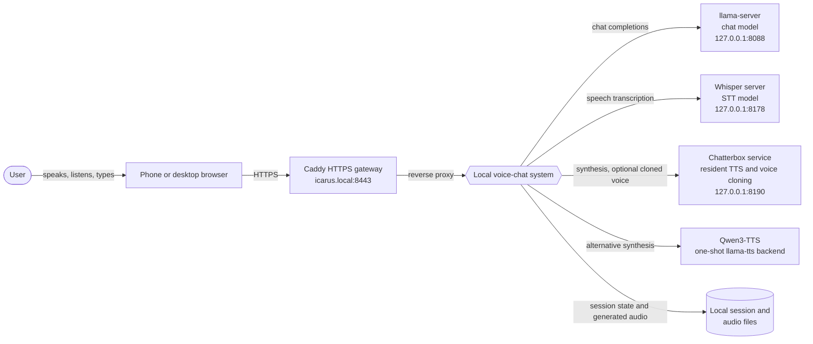
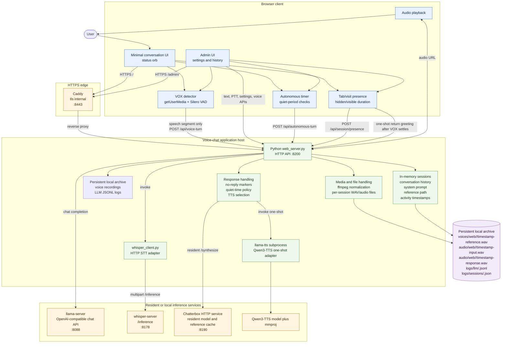
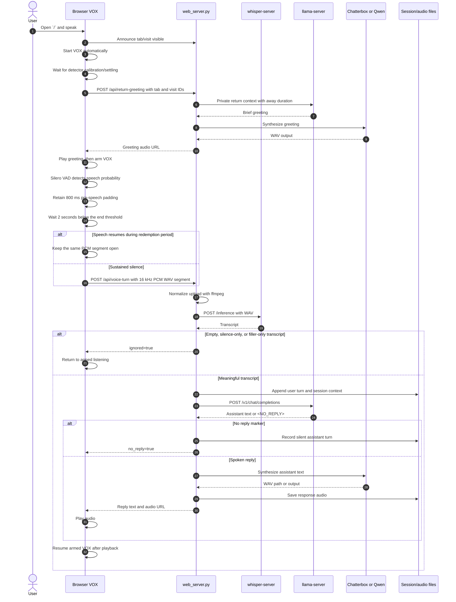

# Voice-chat architecture

This document uses three views:

1. **System context**: the voice-chat system as a black box and the systems around it.
2. **System diagram**: the internal runtime pieces and their boundaries.
3. **Sequences**: the two flows that are easiest to misunderstand: a VOX turn and an autonomous check-in.

The diagrams describe the browser-based deployment on `icarus.local`. The primary `/` route is the locked conversation surface; the full operational frontend is retained under `/admin/`.

## 1. System context — black box



The browser is the only client-facing part. The inference services are local
supporting systems; they are not exposed directly to the browser.

## 2. System diagram — white box



### Runtime boundaries

- **Browser** owns microphone permission, local VOX analysis, recording, tab/visit
  presence, the autonomous timer, and playback. The primary `/` client is locked
  to VOX and the fixed default persona; `/admin/` exposes the operational
  controls. Neither client calls model services directly.
- **`web_server.py`** owns cookie-scoped sessions, history, prompts, tab return
  duration, quiet-time eligibility, no-reply handling, media conversion, and
  orchestration. A return greeting is a one-shot autonomous-style turn tied to
  a browser visit; its private duration context is archived with the turn.
- **Whisper** is resident and receives normalized audio through its HTTP
  `/inference` endpoint.
- **Chatterbox** is resident and keeps the loaded TTS model and processed voice
  conditionals in memory. Qwen3-TTS remains a separate one-shot subprocess
  alternative.
- **`llama-server`** is resident and is the only chat-model process in the
  normal browser path.
- **Session memory is process-local**, so restarting the web server discards the
  live conversation state and active session associations. The media and LLM
  archive is separate and remains on disk for manual inspection or pruning;
  the session manifest and JSONL records connect it back to the session ID and
  UTC timestamps. Archive files are not deleted by session expiry, reset, or
  clear-voice operations.

## 3. Sequence — normal VOX turn



VOX is half-duplex: the browser does not listen for a new utterance while an
assistant response is being processed or played. Local detection prevents idle
microphone audio from being uploaded, while the server-side transcript filter
is the final guard before chat and TTS.

## 4. Sequence — autonomous check-in

```mermaid
sequenceDiagram
    autonumber
    actor User
    participant Browser as Browser JavaScript
    participant Web as web_server.py
    participant Chat as llama-server
    participant TTS as Chatterbox or Qwen

    User->>Browser: Open `/` or complete a text/voice turn
    Browser->>Web: Announce tab visible/away transitions
    Browser->>Browser: Start or reset timer; remain armed if VOX is enabled
    loop Every autonomous interval after the quiet threshold
        Browser->>Browser: Timer fires while page is open
        alt VOX recording, processing, speaking, another request, or audio playback
            Browser->>Browser: Defer and schedule another check
        else VOX armed or disabled
            Browser->>Web: POST /api/autonomous-turn
            Web->>Web: Check last_activity, threshold, and interval
            alt Not eligible
                Web-->>Browser: skipped=true
            else Eligible
                Web->>Chat: Private autonomous prompt plus elapsed quiet context
                Chat-->>Web: <NO_REPLY> or natural response
                alt <NO_REPLY>
                    Web-->>Browser: no_reply=true; no audio
                else Response text
                    Web->>TTS: Synthesize response
                    TTS-->>Web: Audio output
                    Web-->>Browser: Text and audio URL
                    Browser->>User: Display and play response
                end
            end
        end
    end
    User->>Browser: Return to the tab or speak again, or use `/admin/` to type
    Browser->>Web: Visible presence, return greeting, or normal voice/chat request
    Browser->>Browser: Reset autonomous schedule
```

The wake-up mechanism is therefore **frontend timer plus backend eligibility
check**. The backend does not wake itself and cannot initiate a request while
no browser page is open. The model is invoked on every eligible interval, including before the first
user message; it is free to return `<NO_REPLY>` or respond based on the
available conversation and accumulated quiet-time context.

## Microphone lifetime on a phone

Two platform rules decide the shape of `web/app.js`, and breaking either one produced the
"it asks for the microphone again every time it answers" failure on an iPhone:

1. **`getUserMedia()` needs a user gesture.** It is refused with `NotAllowedError` when called
   from the continuation of a `fetch`, and on iOS a permission grant does not outlive the capture
   session - stopping the tracks means the next `getUserMedia()` prompts again.
2. **Media playback needs a gesture too**, per element. An `<audio>` element that has never
   played inside a touch rejects `play()`.

The vendored detector's defaults fight both rules: `pause()` runs `pauseStream`, whose default
**stops** the tracks, and `start()` runs `resumeStream`, whose default **re-runs**
`getUserMedia`. The app pauses the detector on every turn (VOX is half-duplex, so it must not
hear its own answer), which under those defaults ends the capture and re-requests it once per
sentence. `createVad()` therefore overrides both halves of the pair: `pauseStream` mutes the
tracks and `resumeStream` hands the same live stream back. One `MediaStream` is cached in
`state.stream` for the whole visit, and `disableVox()` is the only place the tracks are stopped,
so the microphone is released exactly when the user ends the conversation.

What remains when capture genuinely cannot continue - an incoming call, Siri, iOS swapping the
audio session for playback - cannot be fixed by code, because only a tap can restart it. Those
paths raise `NeedsTapError` and land on the orb ("Tap the light to keep listening", or "Tap to
hear the answer" when playback was refused) rather than a red error box, which used to announce
"permission was denied" when nothing had been denied.

Consequences worth knowing about:

- Starting VOX requires one tap per page visit on iOS. `boot()` still attempts a gesture-less
  start, because it succeeds wherever permissions persist (desktop, Android) and waits quietly
  for the tap where it does not.
- Returning to a backgrounded tab rebuilds the detector graph (`restartVadGraph`) but keeps the
  cached stream, because iOS suspends the `AudioContext` on hide and the library has no hook to
  resume it; without the rebuild the orb reports "Listening" against a dead graph.
- `echoCancellation`, `noiseSuppression` and `autoGainControl` stay on, and the track is muted
  while a turn is in flight, so a held-open microphone cannot pick up the answer.

`tests/browser/` drives the real `app.js` headlessly against a stub that models both platform
rules and the detector's documented `pause`/`start` contract, and asserts that a full turn
performs no `getUserMedia`, that the answer is actually played, and that an interrupted capture
asks for a tap instead of dying. It fails on the behaviour the iPhone was showing and passes on
the current code. It needs a Chrome-family browser: `VOX_BROWSER=/path/to/chrome python3
-m unittest discover -s tests`. Not yet confirmed on a physical iPhone; the scenario is
reconstruction from the two rules above, not measurement.

## Ports and bindings

| Component | Default binding | Role |
|---|---:|---|
| Caddy | `0.0.0.0:8443` | LAN HTTPS entry point and reverse proxy |
| Web server | `0.0.0.0:8200` | Browser UI and orchestration API |
| llama-server | `127.0.0.1:8088` | Resident chat model |
| Whisper server | `127.0.0.1:8178` | Resident speech-to-text model |
| Chatterbox | `127.0.0.1:8190` | Resident speech synthesis and voice cloning |
